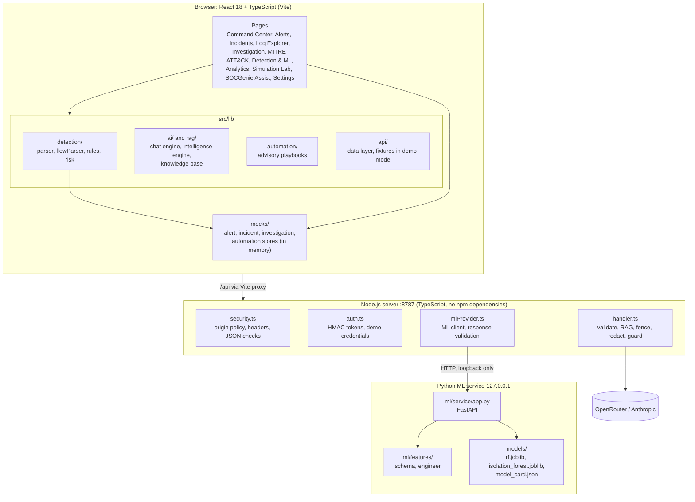
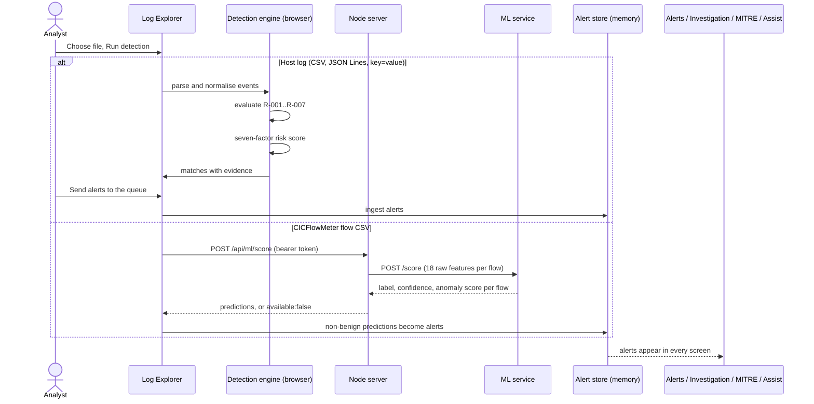
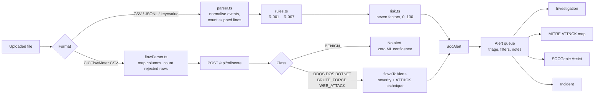
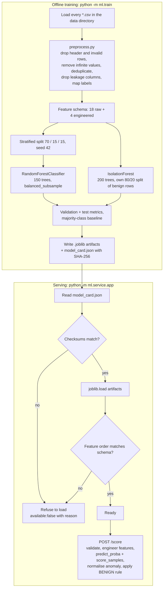
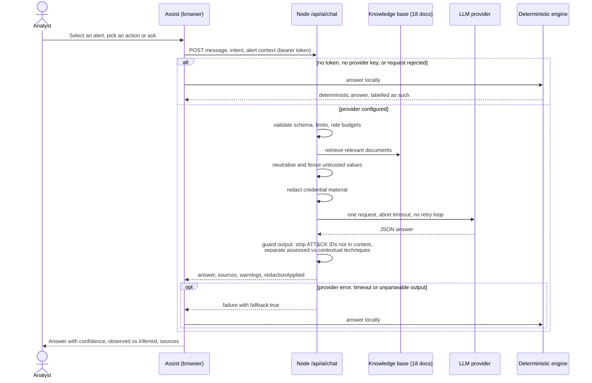
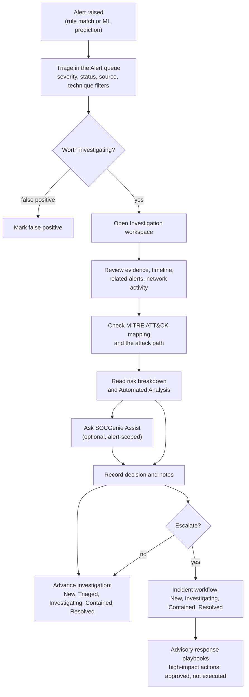

# SOCGenie Architecture

This document describes how SOCGenie is put together, with diagrams drawn from the
actual source. For setup and usage see the [README](../README.md); for endpoint
details see [API.md](API.md); for the ML pipeline see
[MACHINE_LEARNING.md](MACHINE_LEARNING.md).

## 1. System architecture

Two boundaries matter:

- **Browser to server.** The Vite dev server proxies `/api` to the Node server. The
  browser holds no provider key and never learns the provider host.
- **Server to ML service.** The Node server calls `127.0.0.1` only. The ML port is
  configurable through `SOCGENIE_ML_PORT`; the host is hard-coded so a configuration
  value cannot point the server at an arbitrary address.

The data layer in `src/lib/api/` resolves every resource against local fixtures when
`VITE_API_BASE_URL` is unset. The Node server does not implement alert, incident or
analytics resources, so those screens always run on seed data plus whatever is
ingested in the browser. AI chat, ML scoring, login and health use same-origin
`/api` routes that the Node server does implement.

## 2. Data flow

How data moves from an uploaded file to the screens an analyst uses.

Host logs and flow files take different paths because the classifier was trained on
network-flow features; host-telemetry rules `R-001`–`R-004` are rule-only.

## 3. Alert processing

## 4. ML training and inference

## 5. AI analysis workflow (SOCGenie Assist)

The Investigation screen also has an **Automated Analysis** panel. It does not use
this path: it runs the local deterministic engine in the browser and contacts no
external service.

## 6. SOC analyst investigation workflow

Response actions are advisory. SOCGenie has no execution backend, so approving a
high-impact action records the approval and labels it "approved, not executed".

## 7. Design principles

- **Honesty contract.** A status, metric or prediction is shown only if code can
  produce it. Absent capabilities are reported as absent.
- **Fail closed.** No demo password configured: logins refused. Checksum mismatch:
  model not loaded. Unrecognised ML label: rejected, not coerced.
- **Same code at training and serving** for engineered features, so they cannot
  diverge.
- **Evidence-only visuals.** The attack path and technique map use fields the alert
  actually carries; missing stages are omitted rather than invented.
- **Untrusted by default.** Log content, retrieved text, model output and model
  files are all treated as untrusted input at their boundary.
